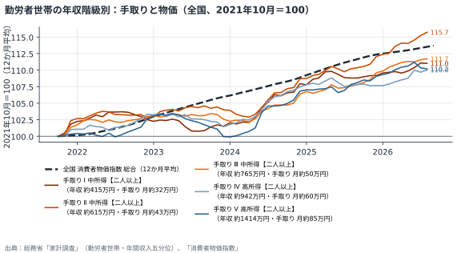
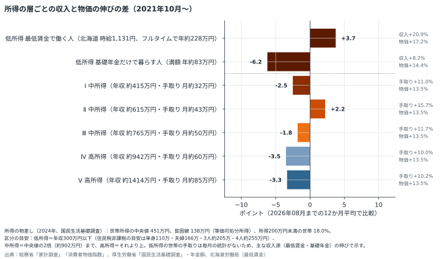
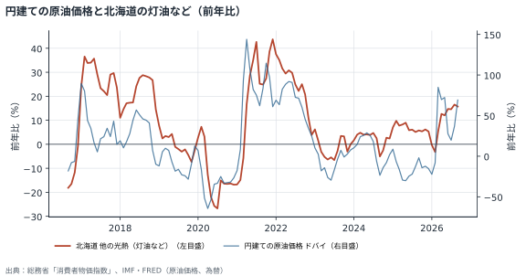
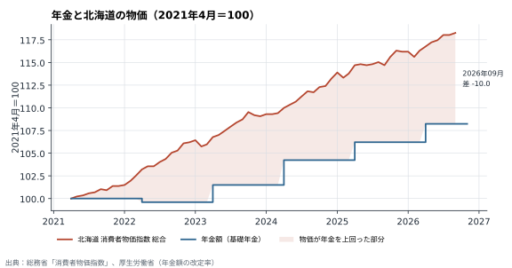
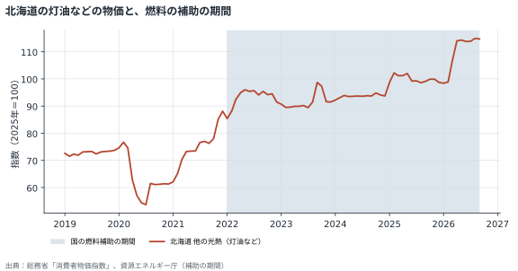
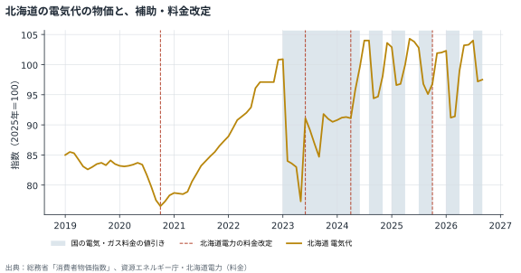
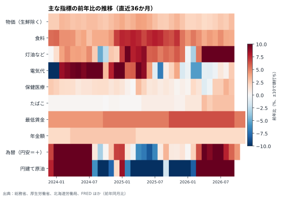
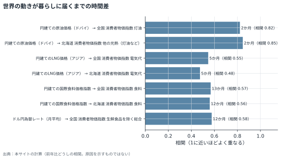

# グラフで見る

グラフは月次レポートと同じデータから毎月作り直しています。帯や縦線は「制度・出来事の年表」から自動で描いています。

## 勤労者世帯の年収階級別：手取りと物価（全国、2021年10月＝100）

勤労者世帯を年収の低い順に5つに分け、手取り（可処分所得）の12か月平均を物価と並べたもの。物価の線より下にある階級は、手取りが物価に追いついていない。かっこ内は各階級の平均の年収（税・社会保険料を引く前）と手取り（月額）。どちらも直近12か月の平均。

## 所得の層ごとの収入と物価の伸びの差（2021年10月〜）

棒が左（マイナス）にある階級ほど、手取りの伸びが物価に届いていない。どの所得の層まで物価高の影響が及んでいるかを見る。低所得は、毎月の家計の統計がないため、主な収入源である最低賃金（フルタイム換算）と基礎年金の伸びで示す。低所得は単身などの1人の収入、中所得・高所得は二人以上の勤労者世帯の年収5階級で、比べている世帯が違う。かっこ内は各階級の平均の年収と手取り（月額）。

## 円建ての原油価格と北海道の灯油など（前年比）

世界の原油価格の動きが、おおむね2か月遅れて北海道の灯油などの物価に届く様子。

## 年金と北海道の物価（2021年4月＝100）

年金の改定は物価の上がり方に追いつかず、差が積み重なっている。

## 北海道の灯油などの物価と、燃料の補助の期間

帯は国の燃料補助の期間。補助がある間は物価が抑えられている。

## 北海道の電気代の物価と、補助・料金改定

帯は国の電気・ガス料金の値引き、縦線は北海道電力の料金改定。

## 主な指標の前年比の推移（直近36か月）

赤いほど前年より上昇、青いほど低下。どの時期に何が重なったかを見る。

## 世界の動きが暮らしに届くまでの時間差

上流の前年比をずらしたとき、下流と最もよく重なったずれと相関（過去20年）。

