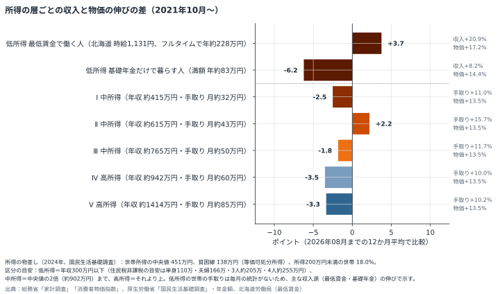
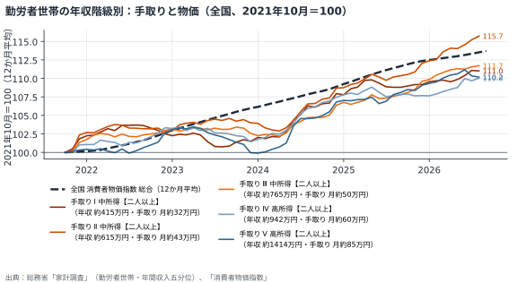
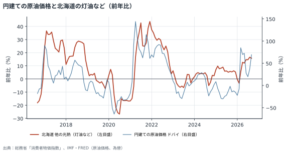
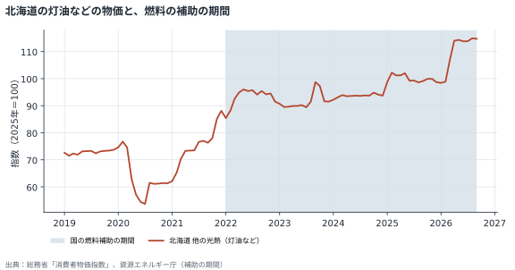

# 暮らしを取り巻く状況（北海道）

経済指標と制度の動きを毎月同じ方法で整理し、生活困窮の相談の背景にありうる**外的な一因**を見えるようにする試みです。判定の基準は目安で、個々の相談者の原因を示すものではありません。

## 最新の確認ポイント（2026年11月5日）

- 年金の伸びが物価の上昇に追いついておらず、年金で暮らす世帯では実質的な目減りが続いている可能性があります。1年ごとの差は小さくても、数年で積み重なります。本人の努力では補いにくい部分です。
- 年金で暮らす単身世帯では、2022年からの年金の伸び（+8.7%）が北海道の物価（+11.5%）に届いていません。（「統計の外にいる世帯」の節を参照）
- 最低賃金は物価以上に上がっています。ただし、働ける時間や仕事の安定は別に確認が必要です。
- 光熱費（灯油・電気など）の負担が前年より重くなっています。光熱費の増加は、使い方よりも値上がりによる部分が大きい可能性があります。
- 医療費（保健医療）・たばこの値段が上がっています。これらの支出の増加には、使う量だけでなく値上がりによる部分が含まれている可能性があります。
- 食料品の値上がりが続いています。食費の増加は、本人の工夫だけでは抑えにくい部分です。
- 燃料や光熱費の一部は補助で価格が抑えられているか、補助が終わったため前年比が高めに出ています。補助が縮小・終了すると、前年比が急に上がることがあります（「観点ごとの判定」の注記を参照）。

[月次レポートの全文を読む](reports/situation_20261105.md)

## 主なグラフ

棒が左（マイナス）にある階級ほど、手取りの伸びが物価に届いていない。どの所得の層まで物価高の影響が及んでいるかを見る。かっこ内は各階級の平均の年収（税・社会保険料を引く前）と手取り（月額）。どちらも直近12か月の平均。対象は二人以上の勤労者世帯だけで、最も低い階級でも世帯所得の中央値に近い層にあたる。相談で多い年収100万円前後の世帯は、この5階級よりさらに下にあり、この統計には含まれない。

勤労者世帯を年収の低い順に5つに分け、手取り（可処分所得）の12か月平均を物価と並べたもの。物価の線より下にある階級は、手取りが物価に追いついていない。かっこ内は各階級の平均の年収（税・社会保険料を引く前）と手取り（月額）。どちらも直近12か月の平均。

世界の原油価格の動きが、おおむね2か月遅れて北海道の灯油などの物価に届く様子。

帯は国の燃料補助の期間。補助がある間は物価が抑えられている。

[すべてのグラフを見る](charts.md)

## このサイトの見方

- **月次レポート**：毎月の判定、確認ポイント、年表、指標の一覧
- **方法**：判定の基準と計算の仕方。限界もここに書いています
- **ご意見をいただきたい点**：研究者の方に特に見ていただきたい論点

