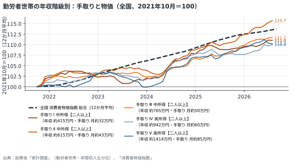
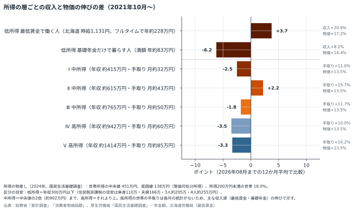
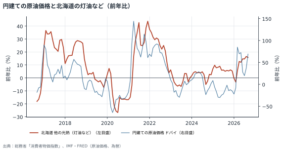
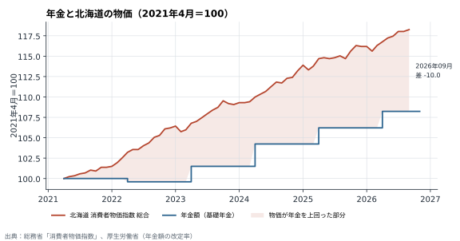
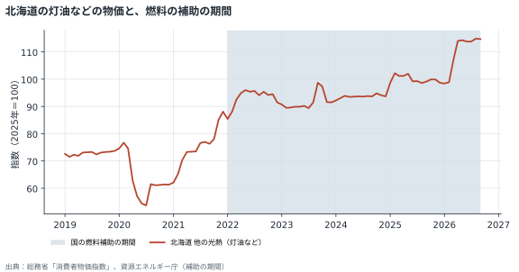
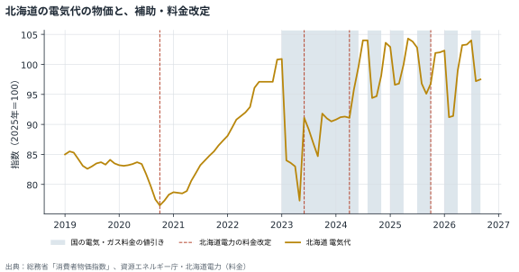
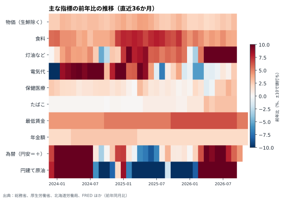
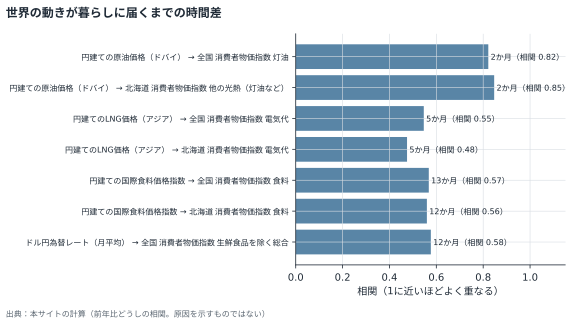

# 暮らしを取り巻く状況（2026年11月05日作成）

経済指標の前年同月との比較から、生活相談の背景にありうる外的な一因を整理したものです。判定の基準は目安で、個々の相談者の原因を示すものではありません。

## 確認ポイント

- 年金の伸びが物価の上昇に追いついておらず、年金で暮らす世帯では実質的な目減りが続いている可能性があります。1年ごとの差は小さくても、数年で積み重なります。本人の努力では補いにくい部分です。
- 年金で暮らす単身世帯では、2022年からの年金の伸び（+8.7%）が北海道の物価（+11.5%）に届いていません。（「統計の外にいる世帯」の節を参照）
- 最低賃金は物価以上に上がっています。ただし、働ける時間や仕事の安定は別に確認が必要です。
- 光熱費（灯油・電気など）の負担が前年より重くなっています。光熱費の増加は、使い方よりも値上がりによる部分が大きい可能性があります。
- 医療費（保健医療）・たばこの値段が上がっています。これらの支出の増加には、使う量だけでなく値上がりによる部分が含まれている可能性があります。
- 食料品の値上がりが続いています。食費の増加は、本人の工夫だけでは抑えにくい部分です。
- 燃料や光熱費の一部は補助で価格が抑えられているか、補助が終わったため前年比が高めに出ています。補助が縮小・終了すると、前年比が急に上がることがあります（「観点ごとの判定」の注記を参照）。

## 観点ごとの判定

「注記」は、補助や制度の変更で前年との比較が動いているものです（config/events.csv の年表から）。

| 観点 | 使った指標 | 時点 | 前年との比較 | 判定 | 注記 |
|---|---|---|---|---|---|
| 物価全体 | 北海道 消費者物価指数 生鮮食品を除く総合 | 2026-09（最新月） | +3.1% | 高い上昇 |  |
| 食料 | 北海道 消費者物価指数 食料 | 2026-09（最新月） | +3.7% | 上昇 |  |
| 医療費（保健医療） | 北海道 消費者物価指数 保健医療 | 2026-09（最新月） | +2.8% | 上昇 | 後期高齢者医療2割負担の配慮措置の終了（2025-10）を含む |
| たばこ | 北海道 消費者物価指数 たばこ | 2026-09（最新月） | +2.9% | 上昇 | 加熱式たばこの税の見直し（2026-04）を含む |
| 酒類 | 北海道 消費者物価指数 酒類 | 2026-09（最新月） | +0.4% | 横ばい |  |
| 灯油など（他の光熱） | 北海道 消費者物価指数 他の光熱（灯油など） | 2026-09（最新月） | +15.7% | 大幅な上昇 | 中東情勢を踏まえた緊急的激変緩和措置で価格が抑えられている（2026-03〜）。前年同月は補助なしのため、前年比は低めに出る |
| 灯油の店頭価格 | 灯油価格 全道 | 2026-10（最新月） | +22.8% | 大幅な上昇 | 中東情勢を踏まえた緊急的激変緩和措置で価格が抑えられている（2026-03〜）。前年同月も補助あり（額は異なる場合がある） |
| 電気代 | 北海道 消費者物価指数 電気代 | 2026-09（最新月） | +2.5% | 横ばい | 電気・ガス料金支援で価格が抑えられている（2026-07〜）。前年同月も補助あり（額は異なる場合がある）。北海道電力の規制料金の改定（2025-10）を含む |
| 為替 | ドル円為替レート（月平均） | 2026-10（最新月） | +4.4% | 大きな変化なし |  |
| 円建ての原油価格 | 円建ての原油価格（ドバイ） | 2026-09（最新月） | +69.2% | 大幅な上昇 |  |
| 有効求人倍率 | 全国 有効求人倍率（除学卒） | 2026-08（最新月） | 0.0ポイント | 横ばい |  |
| 完全失業率 | 全国 完全失業率 | 2026-08（最新月） | 0.0ポイント | 横ばい |  |
| 家計の支出 | 北海道 消費支出（二人以上の勤労者世帯、月額） | 2026-08（直近3か月の平均） | -1.6% | 横ばい |  |
| 家計の支出（収入の低い世帯） | 全国 消費支出（勤労者世帯のうち年収が低い20%、月額） | 2026-08（直近3か月の平均） | +4.5% | 増加 |  |
| 家計の支出（単身の勤労者世帯・北海道東北） | 北海道・東北 消費支出（単身の勤労者世帯、月平均） | 2026-04（最新の四半期） | +9.6% | 増加 |  |
| 家計の支出（単身世帯全体・北海道東北） | 北海道・東北 消費支出（単身世帯全体、月平均） | 2026-04（最新の四半期） | +15.6% | 増加 |  |
| 暮らし向きの見通し | 全国 消費者態度指数 | 2026-08（最新月） | +0.6ポイント | 横ばい |  |
| 賃金（製造業）と物価 | 賃金（製造業・名目）の前年比 − 物価（総合）の前年比。非正規・パート・年金の世帯は含まない | 2026-08（最新月（両方そろう月）） | +3.0ポイント | 収入が物価を上回っている |  |
| 手取り収入（勤労者世帯の平均）と物価 | 北海道 可処分所得（二人以上の勤労者世帯、月額）の前年比 − 北海道 消費者物価指数 総合の前年比 | 2026-08（直近3か月の平均） | +1.1ポイント | 収入が物価を上回っている |  |
| 手取り収入（収入の低い勤労者世帯）と物価 | 全国 可処分所得（勤労者世帯のうち年収が低い20%、月額）の前年比 − 全国 消費者物価指数 総合の前年比 | 2026-08（直近3か月の平均） | +2.3ポイント | 収入が物価を上回っている |  |
| 年金と物価 | 年金額（基礎年金、2021年度=100）の前年比 − 北海道 消費者物価指数 総合の前年比 | 2026-09（直近3か月の平均） | -0.9ポイント | 収入と物価がほぼ同じ | 年金額の改定 +1.9%（2026-04）を含む |
| 最低賃金と物価 | 北海道 最低賃金（時間額）の前年比 − 北海道 消費者物価指数 総合の前年比 | 2026-09（直近3か月の平均） | +3.6ポイント | 収入が物価を上回っている | 北海道の最低賃金 1075円（2025-10）を含む |
| 手取り収入（単身の勤労者世帯・北海道東北）と物価 | 北海道・東北 可処分所得（単身の勤労者世帯、月平均）の前年比 − 北海道 消費者物価指数 総合の前年比 | 2026-04（最新の四半期） | +4.7ポイント | 収入が物価を上回っている |  |
| 年金と物価（2021年度からの累積） | 年金額（基礎年金、2021年度=100）の上がり幅（+8.2%） − 北海道 消費者物価指数 総合の上がり幅（+18.3%） | 2026-09（2021-04から2026-09まで） | -10.0ポイント | 収入が物価に追いついていない | 年金額の改定 +1.9%（2026-04）を含む |
| 最低賃金と物価（2021年10月からの累積） | 北海道 最低賃金（時間額）の上がり幅（+20.9%） − 北海道 消費者物価指数 総合の上がり幅（+17.2%） | 2026-09（2021-10から2026-09まで） | +3.7ポイント | 収入が物価を上回っている | 北海道の最低賃金 1075円（2025-10）を含む |

## グラフ

### 勤労者世帯の年収階級別：手取りと物価（全国、2021年10月＝100）

勤労者世帯を年収の低い順に5つに分け、手取り（可処分所得）の12か月平均を物価と並べたもの。物価の線より下にある階級は、手取りが物価に追いついていない。かっこ内は各階級の平均の年収（税・社会保険料を引く前）と手取り（月額）。どちらも直近12か月の平均。

### 所得の層ごとの収入と物価の伸びの差（2021年10月〜）

棒が左（マイナス）にある階級ほど、手取りの伸びが物価に届いていない。どの所得の層まで物価高の影響が及んでいるかを見る。低所得は、毎月の家計の統計がないため、主な収入源である最低賃金（フルタイム換算）と基礎年金の伸びで示す。低所得は単身などの1人の収入、中所得・高所得は二人以上の勤労者世帯の年収5階級で、比べている世帯が違う。かっこ内は各階級の平均の年収と手取り（月額）。

### 円建ての原油価格と北海道の灯油など（前年比）

世界の原油価格の動きが、おおむね2か月遅れて北海道の灯油などの物価に届く様子。

### 年金と北海道の物価（2021年4月＝100）

年金の改定は物価の上がり方に追いつかず、差が積み重なっている。

### 北海道の灯油などの物価と、燃料の補助の期間

帯は国の燃料補助の期間。補助がある間は物価が抑えられている。

### 北海道の電気代の物価と、補助・料金改定

帯は国の電気・ガス料金の値引き、縦線は北海道電力の料金改定。

### 主な指標の前年比の推移（直近36か月）

赤いほど前年より上昇、青いほど低下。どの時期に何が重なったかを見る。

### 世界の動きが暮らしに届くまでの時間差

上流の前年比をずらしたとき、下流と最もよく重なったずれと相関（過去20年）。

## 統計の外にいる世帯（年金で暮らす単身世帯）

毎月の統計は主に働いている世帯の数字です。ここでは年金制度基礎調査（老齢年金受給者実態調査）令和4年11月1日の全国の数字を基準に、その後の年金と北海道の物価の動きを当てはめています。

**基準（2022-11時点、単身の受給者 約657.6万人）**

- 公的年金が年100万円未満：28.1%。そのうち生活保護を受けているのは15.0%で、残りの多くは保護を受けずに暮らしています
- 支出が収入を上回っていることが明らかな人：約20.9%（少なめの見積もり）
- 貯蓄が100万円未満：28.0%
- 賃貸住宅に住む人：21.1%（家賃の値上がりの影響を受けやすい）
- 働いていない人のうち「働くことができない」：71.2%（配偶者のいない受給者。働いている人の48.6%は「生活にどうしても必要だから」）
- 支出（月額）の中央値：13.0万円

**今の状況（2022-11から2026-09まで）**

- 年金は+8.7%、北海道の物価は+11.5%（差 -2.8ポイント）
- 調査時に月13.0万円（中央値）で暮らしていた人が同じ暮らしを続けると、今は月に約14,913円多くかかる計算です

全国の数字です。北海道ではこれに冬の暖房費（灯油）の上がり方が加わります。実際の家計には、医療費など個人の事情も重なります。この計算は、そのうち物価と年金のずれによる部分（外的な一因）だけを示します。

## 最近と、これからの制度・出来事

直近12か月に始まったもの、6か月以内に終わったもの、これから3か月の予定です。（要確認）は出典で確かめていないものです。年表は config/events.csv と events_local.csv で直せます。

| 状況 | 期間 | 範囲 | 内容 | 対象 |
|---|---|---|---|---|
| これから始まる | 2027-01〜2027-03 | 全国 | 電気・ガス料金支援（2026〜27年の冬。12月からの前倒し案もあり）（要確認） | 全世帯 |
| 実施中（まもなく終了） | 2026-06〜2026-12 | 北海道 | 道民生活応援ポイント：北海道アプリで申請すると、どうみんポイント5,500円分（郵送申請はJCBギフトカード5,000円分）。申請は2026-06-25〜11-16、ポイントの有効期限は12-15 | 全世帯（約282万世帯） |
| 最近始まった・実施中 | 2025-12〜 | 全国 | 国の重点支援地方交付金に、お米券などのための特別枠（1人3,000円相当の目安）。配るかどうかは市町村が判断 | 市町村が決める |
| 最近始まった・実施中 | 2025-12〜 | 全国 | ガソリンの暫定税率の廃止（軽油は2026年4月）（要確認） | 全世帯 |
| 最近始まった・実施中 | 2026-03〜 | 全国 | 中東情勢を踏まえた緊急的激変緩和措置（ガソリン補助の再開）。ガソリン・軽油・灯油・重油が対象。2026-03-19開始、目標はガソリン1L 170円程度。2026-10-29からは1Lあたり52.4円 | 全世帯 |
| 最近始まった・実施中 | 2026-04〜 | 全国 | 加熱式たばこの税の見直し（第1段階。半分を適用） | 喫煙者 |
| 最近始まった・実施中 | 2026-04〜 | 全国 | 年金額の改定 +1.9%（4月分から。実際の支給は6月から） | 年金を受け取る人 |
| 最近始まった・実施中 | 2026-10〜 | 北海道 | 北海道の最低賃金 1131円（+56円） | 働く人 |
| 最近始まった・実施中 | 2026-10〜 | 全国 | 加熱式たばこの税の見直し（第2段階。1箱20〜40円の値上げ） | 喫煙者 |
| 最近始まった・実施中 | 2026-11〜2027-03 | 全国 | 輸入灯油の差額補助：輸入価格と国内卸価格の差（発表時点で1L約20円）を国が補填。北海道の高値が念頭 | 全世帯 |
| 最近あった | 2026-01〜2026-03 | 全国 | 電気・ガス料金支援（1〜3月使用分。低圧の電気 1kWhあたり4.5／4.5／1.5円、都市ガス 1m3あたり18／18／6円） | 全世帯 |
| 最近あった | 2026-02〜2026-05 | 北海道 | 北海道LPガス利用者緊急支援事業（第5次）：2〜5月検針分、1契約あたり最大2,000円（税別）の値引き | LPガスの利用者 |
| 最近あった | 2026-02〜2026-05 | 全国 | 物価高対応子育て応援手当：子ども1人2万円（1回限り）。児童手当の口座に自動で振込 | 子育て世帯（0歳〜高校3年生） |
| 最近終わった | 2026-07〜2026-09 | 北海道 | 北海道LPガス利用者緊急支援事業（第6次）：7〜9月使用分（8〜10月検針分）、最大2,000円（税別）の値引き。約130.8万件 | LPガスの利用者 |
| 最近終わった | 2026-07〜2026-09 | 全国 | 電気・ガス料金支援（7〜9月使用分。低圧の電気 1kWhあたり3.5／4.5／3.5円、都市ガス 14／18／14円） | 全世帯 |

## 世界の動きが暮らしに届くまでの時間差（目安）

上流の前年比を0〜24か月ずらし、下流の前年比と最もよく重なるずれを過去20年で調べたものです。相関は原因を示すものではありません。

| 上流 | 下流 | 時間差 | 相関 | 下流の最新 | 見通し（直線の当てはめ） |
|---|---|---|---|---|---|
| 円建ての原油価格（ドバイ） | 全国 消費者物価指数 灯油 | 2か月 | 0.82 | 2026-09 +15.3% | 2026-11ごろ +27.3% |
| 円建ての原油価格（ドバイ） | 北海道 消費者物価指数 他の光熱（灯油など） | 2か月 | 0.85 | 2026-09 +15.7% | 2026-11ごろ +31.4% |
| 円建ての原油価格（ドバイ） | 灯油価格 全道 | - | - | - | 期間が短い（共通の月が60か月未満） |
| 円建てのLNG価格（アジア） | 全国 消費者物価指数 電気代 | 5か月 | 0.55 | 2026-09 -2.3% | 2027-02ごろ +7.5% |
| 円建てのLNG価格（アジア） | 北海道 消費者物価指数 電気代 | 5か月 | 0.48 | 2026-09 +2.5% | 2027-02ごろ +6.5% |
| 円建ての国際食料価格指数 | 全国 消費者物価指数 食料 | 13か月 | 0.57 | 2026-09 +2.8% | 2027-10ごろ +2.9% |
| 円建ての国際食料価格指数 | 北海道 消費者物価指数 食料 | 12か月 | 0.56 | 2026-09 +3.7% | 2027-09ごろ +3.2% |
| ドル円為替レート（月平均） | 全国 消費者物価指数 生鮮食品を除く総合 | 12か月 | 0.58 | 2026-09 +2.2% | 2027-10ごろ +1.0% |

## 季節の確認ポイント（今月・来月）

- **暖房期**：灯油・電気代が家計の大きな負担になる時期。光熱費の増加が値上がりによるものか、使用量によるものかを確認する
- **冬の準備**：灯油の購入、冬タイヤへの交換、防寒用品など、冬に備えた一時的な出費が重なる
- **冬期の仕事の減少**：建設・農業など屋外の仕事が減り、季節労働の人の収入が減ったり、仕事が途切れたりしやすい
- **年末**：年末年始の出費が増える。冬休みで給食がなくなり、子どもの食費が増える

## 指標の一覧（最新値と前年との比較）

「過去10年での位置」は、最新の変化が過去10年の変化の何％より大きいかを示します（95なら、過去10年でも大きい上昇）。

| 層 | 指標 | 時点 | 値 | 前年との比較 | 過去10年での位置 | 注記 |
|---|---|---|---|---|---|---|
| 世界 | 米国政策金利（FF金利、月平均） | 2026-10 | 3.88 % | -0.2ポイント（前年同月差） | 35 |  |
| 世界 | ドル円為替レート（月平均） | 2026-10 | 157.97 円/ドル | +4.4%（前年同月比） | 62 |  |
| 世界 | 原油価格 WTI（月平均） | 2026-10 | 102.07 ドル/バレル | +67.6%（前年同月比） | 91 |  |
| 世界 | 原油価格 ドバイ（月平均） | 2026-09 | 111.83 ドル/バレル | +59.9%（前年同月比） | 88 |  |
| 世界 | LNG価格 アジア（月平均） | 2026-09 | 26.64 ドル/百万BTU | +136.2%（前年同月比） | 86 |  |
| 世界 | 国際的な食料価格指数 | 2026-09 | 137.11 指数（2016年=100） | +8.3%（前年同月比） | 78 |  |
| 国内 | 全国 消費者物価指数 総合 | 2026-09 | 102.20 指数（2025年=100） | +2.1%（前年同月比） | 63 |  |
| 国内 | 全国 消費者物価指数 生鮮食品を除く総合 | 2026-09 | 102.30 指数（2025年=100） | +2.2%（前年同月比） | 67 |  |
| 国内 | 全国 消費者物価指数 食料 | 2026-09 | 103.60 指数（2025年=100） | +2.8%（前年同月比） | 52 |  |
| 国内 | 全国 消費者物価指数 電気代 | 2026-09 | 92.50 指数（2025年=100） | -2.3%（前年同月比） | 32 | 電気・ガス料金支援で価格が抑えられている（2026-07〜）。前年同月も補助あり（額は異なる場合がある） |
| 国内 | 全国 消費者物価指数 灯油 | 2026-09 | 114.80 指数（2025年=100） | +15.3%（前年同月比） | 68 | 中東情勢を踏まえた緊急的激変緩和措置で価格が抑えられている（2026-03〜）。前年同月は補助なしのため、前年比は低めに出る |
| 国内 | 全国 有効求人倍率（除学卒） | 2026-08 | 1.18 倍 | 0.0ポイント（前年同月差） | 38 |  |
| 国内 | 全国 新規求人数（除学卒） | 2026-08 | 787,309.00 人 | -2.3%（前年同月比） | 38 |  |
| 国内 | 全国 完全失業率 | 2026-08 | 2.52 % | 0.0ポイント（前年同月差） | 61 |  |
| 国内 | 全国 きまって支給する給与（製造業、名目） | 2026-08 | 117.60 指数（2020年=100） | +4.9%（前年同月比） | 98 |  |
| 国内 | 全国 家計消費支出（勤労者世帯、前年同月比） | 2026-08 | -4.70 % | -4.7%（前年同月比（公表値）） | 11 |  |
| 国内 | 全国 商業販売額（小売業、前年同月比） | 2026-08 | 2.90 % | +2.9%（前年同月比（公表値）） | 72 |  |
| 国内 | 全国 消費者態度指数 | 2026-08 | 35.50 指数 | +0.6ポイント（前年同月差） | 59 |  |
| 国内 | 全国 実収入（二人以上の勤労者世帯、月額） | 2026-08 | 616,704.00 円 | +1.3%（前年同月比） | 32 |  |
| 国内 | 全国 可処分所得（二人以上の勤労者世帯、月額） | 2026-08 | 513,617.00 円 | +1.4%（前年同月比） | 37 |  |
| 国内 | 全国 消費支出（二人以上の勤労者世帯、月額） | 2026-08 | 331,134.00 円 | -4.7%（前年同月比） | 10 |  |
| 国内 | 全国 可処分所得（勤労者世帯のうち年収が低い20%、月額） | 2026-08 | 351,650.00 円 | -0.6%（前年同月比） | 28 |  |
| 国内 | 全国 消費支出（勤労者世帯のうち年収が低い20%、月額） | 2026-08 | 240,809.00 円 | -2.5%（前年同月比） | 19 |  |
| 国内 | 全国 可処分所得（勤労者世帯のうち年収が下から20〜40%、月額） | 2026-08 | 460,789.00 円 | +5.1%（前年同月比） | 70 |  |
| 国内 | 全国 可処分所得（勤労者世帯のうち年収が中位（40〜60%）、月額） | 2026-08 | 474,255.00 円 | +1.9%（前年同月比） | 42 |  |
| 国内 | 全国 可処分所得（勤労者世帯のうち年収が上から20〜40%、月額） | 2026-08 | 561,113.00 円 | +4.0%（前年同月比） | 66 |  |
| 国内 | 全国 可処分所得（勤労者世帯のうち年収が高い20%、月額） | 2026-08 | 720,278.00 円 | -2.1%（前年同月比） | 14 |  |
| 国内 | 全国 年間収入（勤労者世帯のうち年収が低い20%） | 2026-08 | 432.00 万円 | +6.4%（前年同月比） | 96 |  |
| 国内 | 全国 年間収入（勤労者世帯のうち年収が下から20〜40%） | 2026-08 | 637.00 万円 | +4.9%（前年同月比） | 97 |  |
| 国内 | 全国 年間収入（勤労者世帯のうち年収が中位（40〜60%）） | 2026-08 | 784.00 万円 | +3.8%（前年同月比） | 82 |  |
| 国内 | 全国 年間収入（勤労者世帯のうち年収が上から20〜40%） | 2026-08 | 957.00 万円 | +2.8%（前年同月比） | 74 |  |
| 国内 | 全国 年間収入（勤労者世帯のうち年収が高い20%） | 2026-08 | 1,438.00 万円 | +2.9%（前年同月比） | 67 |  |
| 国内 | 年金額（基礎年金、2021年度=100） | 2026-11 | 108.23 指数（2021年度=100） | +1.9%（前年同月比） | 65 | 年金額の改定 +1.9%（2026-04）を含む |
| 北海道 | 北海道 消費者物価指数 総合 | 2026-09 | 103.00 指数（2025年=100） | +3.1%（前年同月比） | 73 |  |
| 北海道 | 北海道 消費者物価指数 生鮮食品を除く総合 | 2026-09 | 103.10 指数（2025年=100） | +3.1%（前年同月比） | 79 |  |
| 北海道 | 北海道 消費者物価指数 食料 | 2026-09 | 104.10 指数（2025年=100） | +3.7%（前年同月比） | 57 |  |
| 北海道 | 北海道 消費者物価指数 保健医療 | 2026-09 | 103.40 指数（2025年=100） | +2.8%（前年同月比） | 98 | 後期高齢者医療2割負担の配慮措置の終了（2025-10）を含む |
| 北海道 | 北海道 消費者物価指数 たばこ | 2026-09 | 103.10 指数（2025年=100） | +2.9%（前年同月比） | 67 | 加熱式たばこの税の見直し（2026-04）を含む |
| 北海道 | 北海道 消費者物価指数 酒類 | 2026-09 | 100.90 指数（2025年=100） | +0.4%（前年同月比） | 45 |  |
| 北海道 | 北海道 消費者物価指数 電気代 | 2026-09 | 97.50 指数（2025年=100） | +2.5%（前年同月比） | 49 | 電気・ガス料金支援で価格が抑えられている（2026-07〜）。前年同月も補助あり（額は異なる場合がある）。北海道電力の規制料金の改定（2025-10）を含む |
| 北海道 | 北海道 消費者物価指数 他の光熱（灯油など） | 2026-09 | 114.70 指数（2025年=100） | +15.7%（前年同月比） | 66 | 中東情勢を踏まえた緊急的激変緩和措置で価格が抑えられている（2026-03〜）。前年同月は補助なしのため、前年比は低めに出る |
| 北海道 | 北海道 消費者物価指数 光熱・水道 | 2026-09 | 102.90 指数（2025年=100） | +7.9%（前年同月比） | 75 |  |
| 北海道 | 北海道 実収入（二人以上の勤労者世帯、月額） | 2026-08 | 570,612.00 円 | +5.9%（前年同月比） | 67 |  |
| 北海道 | 北海道 可処分所得（二人以上の勤労者世帯、月額） | 2026-08 | 477,807.00 円 | +4.5%（前年同月比） | 62 |  |
| 北海道 | 北海道 消費支出（二人以上の勤労者世帯、月額） | 2026-08 | 291,793.00 円 | -1.5%（前年同月比） | 43 |  |
| 北海道 | 北海道 最低賃金（時間額） | 2026-11 | 1,131.00 円 | +5.2%（前年同月比） | 73 | 北海道の最低賃金 1131円（2026-10）を含む |
| 北海道 | 北海道・東北 可処分所得（単身の勤労者世帯、月平均） | 2026-04 | 348,938.00 円 | +6.8%（前年同月比） | 67 |  |
| 北海道 | 北海道・東北 消費支出（単身の勤労者世帯、月平均） | 2026-04 | 202,616.00 円 | +9.6%（前年同月比） | 74 |  |
| 北海道 | 北海道・東北 消費支出（単身世帯全体、月平均） | 2026-04 | 185,262.00 円 | +15.6%（前年同月比） | 95 |  |
| 北海道 | 灯油価格 全道 | 2026-10 | 152.80 円/1L（配達） | +22.8%（前年同月比） | - | 中東情勢を踏まえた緊急的激変緩和措置で価格が抑えられている（2026-03〜）。前年同月も補助あり（額は異なる場合がある） |
| 北海道 | 灯油価格 道北 | 2026-10 | 148.50 円/1L（配達） | +19.1%（前年同月比） | - |  |
| 北海道 | 灯油価格 十勝 | 2026-10 | 156.00 円/1L（配達） | +27.3%（前年同月比） | - |  |
| 北海道 | プロパンガス価格 全道 | 2026-10 | 7,368.00 円/5㎥ | +6.3%（前年同月比） | - | 北海道LPガス利用者緊急支援事業（要確認）で価格が抑えられている（2023-10〜）。前年同月も補助あり（額は異なる場合がある） |
| 北海道 | プロパンガス価格 道北 | 2026-10 | 7,329.00 円/5㎥ | +3.3%（前年同月比） | - |  |
| 北海道 | プロパンガス価格 十勝 | 2026-10 | 6,841.00 円/5㎥ | +9.0%（前年同月比） | - |  |
| 北海道 | ガソリン価格 全道 | 2026-10 | 168.00 円/1L（レギュラー） | -0.6%（前年同月比） | - | 中東情勢を踏まえた緊急的激変緩和措置で価格が抑えられている（2026-03〜）。前年同月も補助あり（額は異なる場合がある）。ガソリンの暫定税率の廃止（要確認）（2025-12）を含む |
| 北海道 | ガソリン価格 道北 | 2026-10 | 173.00 円/1L（レギュラー） | -0.6%（前年同月比） | - |  |
| 北海道 | ガソリン価格 十勝 | 2026-10 | 169.00 円/1L（レギュラー） | 0.0%（前年同月比） | - |  |
| 世界 | 円建ての原油価格（ドバイ） | 2026-09 | 17,491.38 円/バレル | +69.2%（前年同月比） | 84 |  |
| 世界 | 円建てのLNG価格（アジア） | 2026-09 | 4,166.48 円/百万BTU | +149.9%（前年同月比） | 86 |  |
| 世界 | 円建ての国際食料価格指数 | 2026-09 | 21,446.01 指数×円 | +14.5%（前年同月比） | 78 |  |
